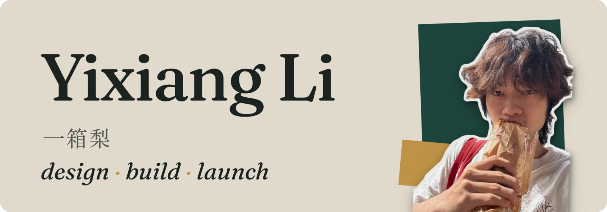
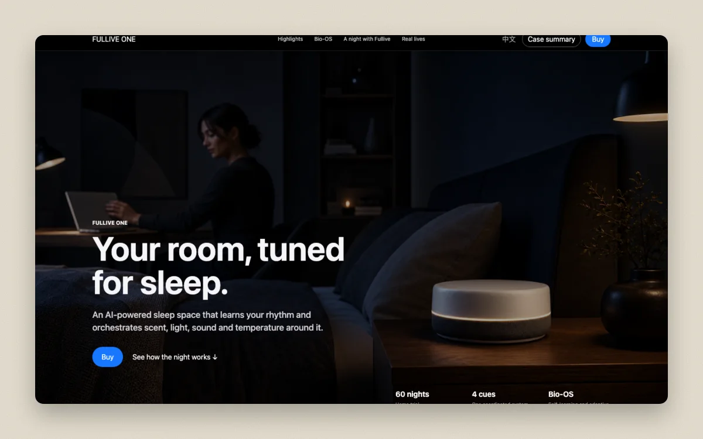

<picture>
  <source media="(prefers-color-scheme: dark)" srcset="assets/banner-dark.webp">
  
</picture>

I design products, build them with Claude Code and Codex, and take them to market. The agents write most of the code. I decide what gets made and when it is good enough to ship.

At Fullive in 2026 I wrote Somni's entry for the CES Innovation Awards, and it was named a [CES 2027 Innovation Awards Honoree](https://www.ces.tech/ces-innovation-awards/2027/fullive-somni/). I also built Somni's waitlist page and ran its pre-launch Meta ads: 272 leads at $3.66 each.

**[Co-read · Thinking, Fast and Slow](https://coread.yixiangli.com/thinking-fast-slow/).** Co-read is my video series about books, and every episode comes with a website you can play. In the first one, a book opens into a sea chart with nine islands, one for each of the book's best-known experiments. Answer on instinct with the hare, then press and hold the tortoise to watch the slow answer get worked out. Everything on screen, from the book to the hare, is generated in three.js code, with no 3D model files. English and Chinese. [Source](https://github.com/Yixiang-Li/thinking-fast-slow)

<table>
<tr>
<td width="50%" valign="top">
<a href="https://yixiang-li.github.io/fullive-gtm-case/"><picture><source media="(prefers-color-scheme: dark)" srcset="assets/card-fullive-dark.webp"></picture></a>

<b><a href="https://yixiang-li.github.io/fullive-gtm-case/">Fullive go-to-market case</a></b> 
A five-part GTM take-home I wrote for Fullive in July 2026: competitor research, a concept survey, creator sourcing, a landing page and the AI workflow behind them. English and Chinese. <a href="https://github.com/Yixiang-Li/fullive-gtm-case">Source</a>

</td>
<td width="50%" valign="top">
<a href="https://github.com/Yixiang-Li/thin-muscle-sun-pet"><picture><source media="(prefers-color-scheme: dark)" srcset="assets/card-pets-dark.webp"></picture></a>

<b><a href="https://github.com/Yixiang-Li/thin-muscle-sun-pet">Pets your agent installs</a></b> 
Two cartoon pets for Codex, one always at the gym and one always watching. Each repo ships an <code>AGENTS.md</code>, so pasting the link into Codex is the whole install. Repos: <a href="https://github.com/Yixiang-Li/thin-muscle-sun-pet">Sun</a> · <a href="https://github.com/Yixiang-Li/spectator-feng-pet">Feng</a>

</td>
</tr>
</table>

**Also**

- **Meshy AI**, growth product intern, 2025–26. Tied referral rewards to the invitee's first payment, set regional prices for Latin America and India, and tested new share-link pages in PostHog.
- **Bosch**, data analysis intern, 2026. Helped build an internal data-analysis agent on Copilot Studio.
- **[evidence-led-marketing-agent](https://github.com/Yixiang-Li/evidence-led-marketing-agent)**, an agent skill that makes the agent rank its sources and keep facts apart from guesses.
- First-year HCI master's student at Université Paris-Saclay.

Open to launch and growth work with AI teams. [X @YixiangLi_](https://x.com/YixiangLi_) · [LinkedIn](https://www.linkedin.com/in/yixiang-li-9099b7322/)
